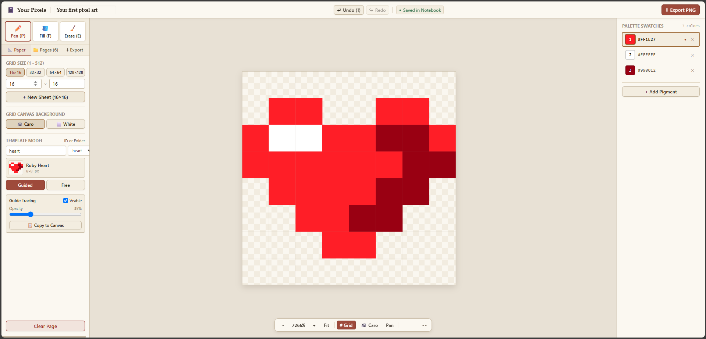

# 🎨 Your Pixels
### *A Cozy, Distraction-Free Online Pixel Art Studio*

 

 
 

 

### 🚀 **[👉 Click here to start drawing in your browser (https://lovinu99.github.io/playPixels/)](https://lovinu99.github.io/playPixels/)**
*100% Free Forever • Zero Data Collected • Full Commercial Rights • No Account Required*

---

> [!IMPORTANT]
> ### 🛡️ Our Lifetime Freedom, Privacy & Ownership Pledge
> 
> - 💚 **Committed Free Forever — Zero Fees, All Time**: No subscriptions, no paywalls, no trial limits, and no hidden "pro" tiers. Your Pixels is 100% free to use today and committed to remaining free forever for everyone.
> - 🔒 **Zero Data Collection — 100% Private**: We do not collect, track, or share any personal information. No accounts, no email sign-ups, no cookies, and no tracking scripts. The application runs strictly inside your own browser and your artworks stay entirely on your device.
> - 🎨 **Full Ownership of Your Artwork (Free for Commercial & Personal Use)**: Every single pixel and piece of artwork you create belongs **100% to you**. You have full, unconditional copyright and ownership over your exported PNGs and project files. Feel free to use them in commercial games, merchandise, client projects, book illustrations, avatars, or NFTs without royalties or mandatory attribution.

---

## ✨ Why Create with Your Pixels?

Whether you are crafting game sprites, designing icons, creating pixel avatars, or just doodling for fun, **Your Pixels** provides a warm, notebook-inspired canvas designed for pure creativity right in your web browser.

---

### 🖌️ Intuitive & Fluid Drawing Tools
- **Pixel Pen (`P`)**: Place clean, crisp pixels with seamless stroke interpolation that never skips, even during rapid mouse movements.
- **Bucket Fill (`F`)**: Instantly flood-fill matching connected regions with a single click.
- **Eraser (`E`)**: Quickly clean up mistakes and clear cells.
- **Undo & Redo**: Experiment freely with full Undo (`Ctrl + Z`) and Redo support.

---

### 🔍 Deep Zoom & Comfortable Canvas Navigation
- **Ultra-Fine Zoom (1× to 48×)**: Zoom in close to polish single-pixel details or zoom out to admire your full artwork.
- **Effortless Panning**: Hold the **Spacebar** or click and drag with your **Middle Mouse Button** to glide anywhere across the sheet.
- **Pixel Grid Toggle**: Switch the pixel boundary grid on or off for pixel-perfect precision.
- **Flexible Canvas Dimensions**: Jump right in with classic presets ($16\times16$, $32\times32$, $64\times64$, $128\times128$) or set your own custom canvas dimensions up to $512\times512$.

---

### 🎨 Color Palette & Custom Pigments
- **Palette Swatches**: Keep your favorite colors pinned on the right-hand sidebar for quick access anytime.
- **Full Color Picker**: Choose any shade with HEX and RGB input to dial in your exact aesthetic.
- **Quick Swatch Switching**: Easily cycle through recent colors as you shade and highlight.

---

### 🖼️ Guided Practice Templates
Never face an intimidating blank canvas again!
- **Built-in Starters**: Practice drawing charming sprites including **Ruby Heart**, **Green Slime**, **Pixel Sword**, and **Rubber Duck**.
- **Guided Mode**: Overlays a translucent outline of the model so you can learn pixel shading, proportions, and coloring step-by-step.
- **Free Mode**: Switch to a clean blank page whenever inspiration strikes.

---

### 💾 Safe Auto-Save — Never Lose Progress
- **Always Saved Locally**: Every stroke is automatically saved directly in your browser. Feel free to close the tab, refresh, or take a break — your artwork is right there when you return.
- **Multiple Drawing Sheets**: Create and manage multiple artworks and switch between pages seamlessly.

---

### 📤 Crisp Export & Complete Freedom
- **Pixel-Perfect PNG Export**: Download crisp 1:1 PNG images with zero blur or compression artifacts — ready for commercial game engines, Discord avatars, emotes, or social media.
- **Save Project**: Export lightweight project files to back up your art or share with friends.
- **Total Creative Rights**: You own 100% of the output with no watermarks and no royalties.

---

## ⌨️ Helpful Keyboard Shortcuts

| Shortcut / Action | Action |
| :--- | :--- |
| **`P`** | Select **Pixel Pen** |
| **`F`** | Select **Bucket Fill** |
| **`E`** | Select **Eraser** |
| **Mouse Wheel** | Zoom In / Out (1× – 48×) |
| **Spacebar + Drag** | Pan across canvas |
| **Middle Click + Drag** | Pan across canvas |
| **`Ctrl` + `Z`** | Undo |

---

  
🎨 Made with love for pixel art enthusiasts worldwide. Happy creating!

  
<b><a href="https://lovinu99.github.io/playPixels/">👉 Launch Your Pixels: https://lovinu99.github.io/playPixels/</a></b>

